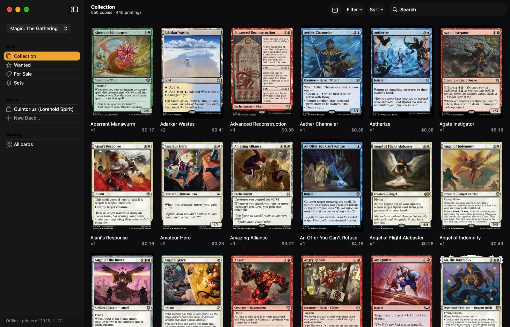
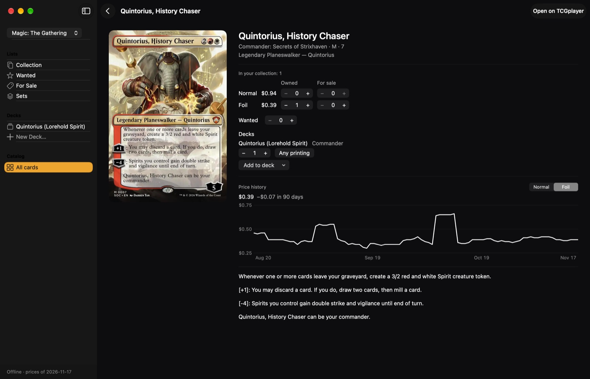
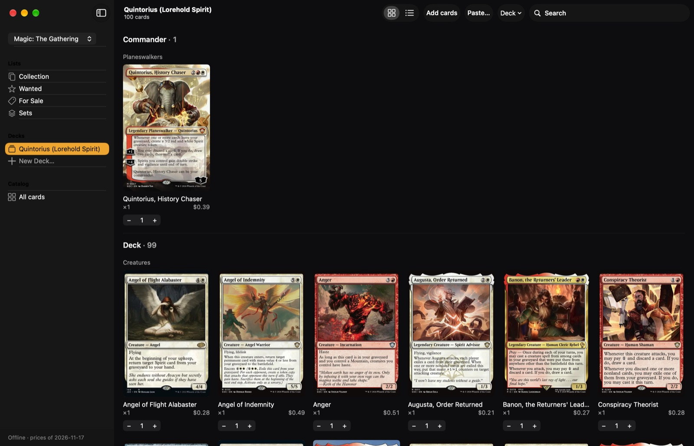
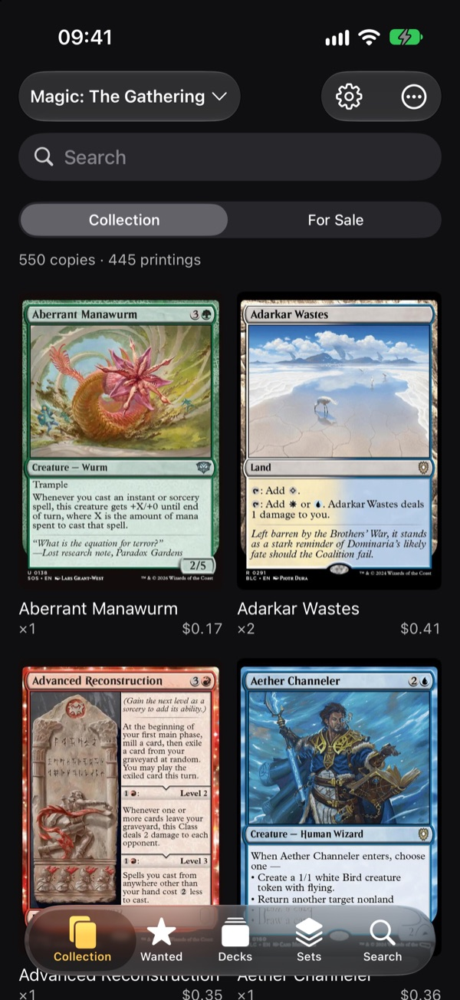
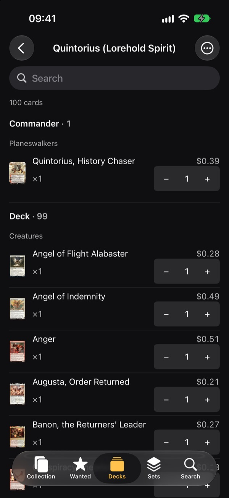

# TCG Collection

A SwiftUI app for Mac and iPhone that tracks trading card collections, with a local card catalog and daily prices.
It covers four games: **Magic: The Gathering**, **Yu-Gi-Oh!**, **Riftbound** and **Cyberpunk TCG**.

There is no server and no account. Each device downloads the public catalog and prices itself, keeps them on disk, and
works offline afterwards. What you own lives in plain JSON files in a folder you choose (iCloud Drive by default), so
the Mac and the iPhone share it.



| A card page with its 90-day price history | A Commander deck |
| --- | --- |
|  |  |

<p align="center">
  
  &nbsp;&nbsp;
  
</p>

## What it does

- **Collection.** Add cards by hand on a card page, one count per printing and finish, or import a TCGplayer CSV export.
  The import shows every new, changed and missing row before it writes anything.
- **Wanted and For Sale.** A wanted list (with an optional pinned printing) and a for-sale list, a "Sold" action that
  keeps a record, and a PDF of either list.
- **Decks.** Decks with each game's sections and formats (for example Commander, Extra Deck, Side Deck, Champion,
  Legends), rule warnings, a deck text paste with suggestions for misspelt names, and a gallery or list view. When two
  active decks need the same copies, you decide per card whether they share them or you buy more; the missing copies
  go to Wanted.
- **Sets.** Every set counted as a master set (each printing in each finish), with the cost to complete it.
- **Prices and history.** The day's TCGplayer market prices for every printing, and a 90-day price chart per printing
  from tcgcsv's daily archives (downloaded only after you say yes).
- **Roles.** Follow only the games you play, and turn the player role (decks) or the collector role (sets) on or off
  per game.
- **iPhone.** The same features in a tab bar, on the same folder.

The interface is English and always dark.

## Data sources

- [tcgcsv.com](https://tcgcsv.com): the catalog and prices of all four games (a mirror of TCGplayer), and its daily
  price archives. The app follows its usage rules: the data changes once a day, so a set is never fetched twice in one
  UTC day, an archive is never downloaded twice, nothing polls, and at most 4 requests run at a time.
- Card pictures: TCGplayer's product pictures, and [YGOPRODeck](https://ygoprodeck.com) for Yu-Gi-Oh! (clean renders
  instead of scans). Every picture is downloaded once and kept on the device.

This project is not affiliated with TCGplayer, tcgcsv, YGOPRODeck or the publishers of the games. Card names,
pictures and game names belong to their owners.

## Requirements

- macOS 27 and Xcode 27 (Swift 6). The iPhone build targets iOS 27.
- [XcodeGen](https://github.com/yonaskolb/XcodeGen): the `.xcodeproj` is generated from `project.yml`.
- No third-party Swift packages. The system `libarchive` reads the 7z price archives.

## Build and run

```sh
cp Config/Local.xcconfig.example Config/Local.xcconfig   # set your Apple team id (a free account works)
xcodegen generate
open TCGCollection.xcodeproj                              # run the TCGCollection scheme on "My Mac" or an iPhone
```

Or from the command line:

```sh
scripts/install-mac.sh             # Release build -> /Applications/TCG Collection.app
scripts/install-iphone.sh --dry-run  # the paired iPhone and the commands; without --dry-run it builds and installs
```

With a free Apple account an iPhone build runs for 7 days; install it again after that (the app keeps its data).

## Tests

```sh
# Unit tests (Swift Testing, macOS)
xcodebuild test -project TCGCollection.xcodeproj -scheme TCGCollection -destination 'platform=macOS' -derivedDataPath build

# Mac UI tests (XCUITest; they take the pointer while they run)
scripts/ui-test.sh

# iPhone UI tests in the iOS Simulator (iPhone 17)
scripts/ui-test-phone.sh
```

Tests never use the network or a real store: they run on saved samples of each source in
`TCGCollectionTests/Fixtures` and a temporary folder.

## Project layout

```
project.yml                 XcodeGen project
TCGCollection/              the app: App, Catalog, Prices, Pictures, User (the folder's files and their rules),
                            CSV, PDF, Games (each game's definition), Views, Look (the theme)
TCGCollectionTests/         unit tests and fixtures
TCGCollectionUITests/       Mac UI tests
TCGCollectionPhoneUITests/  iPhone UI tests
scripts/                    install, UI test and console scripts
docs/deck-rules-sources.md  the official source of every deck rule number the app checks
docs/screenshots/           the pictures in this README
```

## How it was built

The app was built in 8 days (November 11–18, 2026) by one developer directing [Claude Code](https://claude.com/claude-code)
agents, in seven phases: the catalog, the collection and its lists, decks, sets and roles, price history, the iPhone,
and the retirement of an earlier version.

- **Design first.** A written design came before any code. Every open product question went back to the owner as an
  explicit decision, recorded with its reason.
- **One plan per phase.** Each phase had an implementation plan split into small tasks, with the exact behaviour,
  tests and constraints of each.
- **One agent per task, then a review.** A fresh agent built each task test-first; a separate reviewer checked it
  against the plan and for code quality, and findings went back for a fix round. At the end of each phase a
  whole-branch review and one fix wave closed it.
- **Checked on the real thing.** Every phase ended with the full UI test suite, an install, and a check by the owner
  on his own Mac and iPhone; the iPhone build was run on a real device with a step log read over the cable.

The result: 1,225 unit tests, 121 Mac UI tests and 28 iPhone UI tests, and no third-party dependency.

## License

MIT. See [LICENSE](LICENSE).
